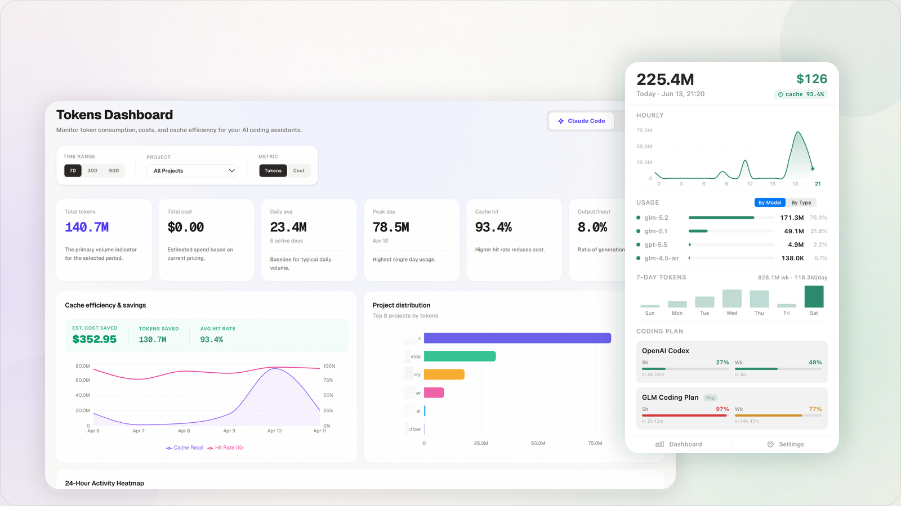
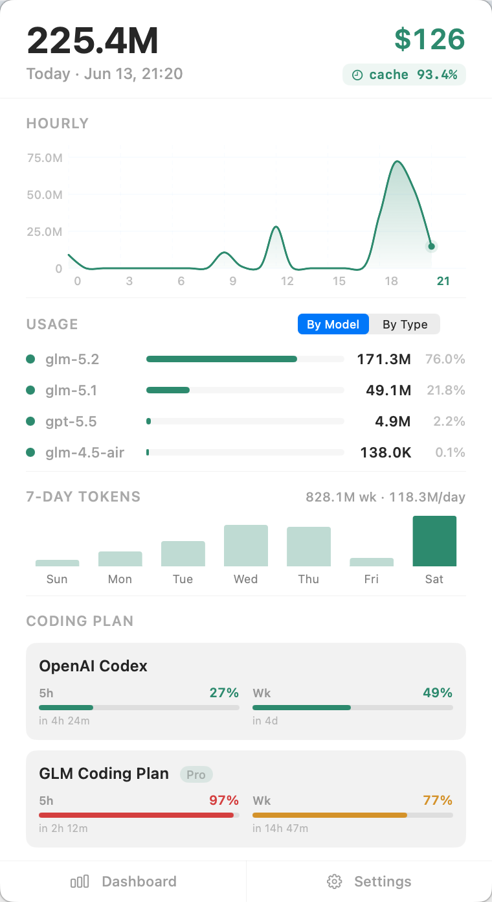
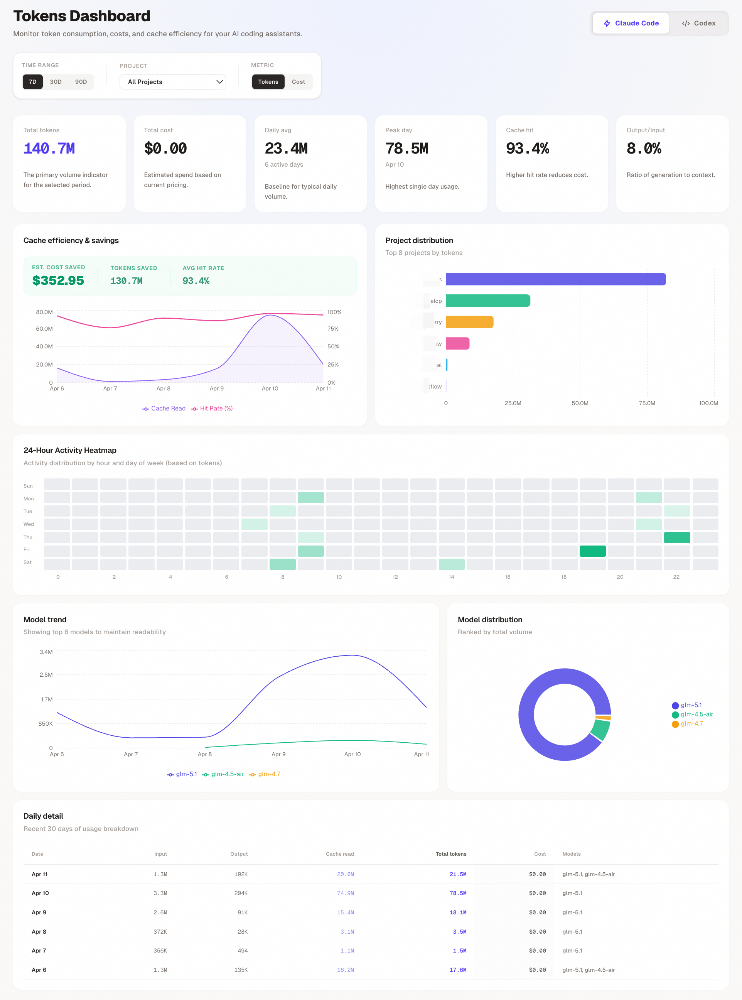

<div align="center">
  
<p align="center">
  
</p>
  
# TokenDash
  
  **Your local command center for AI coding usage.**

  Track tokens, costs, models, projects, and coding-plan limits from the macOS menu bar or the Ubuntu system tray, with a detailed local dashboard when you need to dig deeper.

  [](https://github.com/zhangferry/tokendash/releases/latest)
  [](https://www.npmjs.com/package/@zhangferry-dev/tokendash)
  [](https://github.com/zhangferry/tokendash/actions/workflows/test.yml)
  [](LICENSE)

  [Download for macOS](https://github.com/zhangferry/tokendash/releases/latest) · [Download for Ubuntu](https://github.com/zhangferry/tokendash/releases/latest) · [Download for Windows](https://github.com/zhangferry/tokendash/releases/latest) · [Run with npx](#run-the-web-dashboard) · [Features](#what-you-get) · [Development](#development)
</div>



## Why TokenDash?

AI coding tools make it easy to consume millions of tokens without a clear picture of where they went. TokenDash turns local session data into an at-a-glance view of today's activity and a deeper history of your usage.

- **Glanceable by design** — see today's tokens, estimated cost, cache rate, model mix, and quota status without leaving the menu bar or system tray.
- **One view across tools** — bring Claude Code, Codex, OpenClaw, OpenCode, Pi, and DeepSeek Harness usage into the same product.
- **Local-first** — usage history is parsed directly from files already stored on your machine.
- **Useful beyond totals** — understand hourly activity, model and project distribution, cache efficiency, code changes, and tool calls.
- **No companion analytics service** — the dashboard runs on your computer and does not require an account.

## Quick Start

### macOS Menu Bar App

The native menu bar app is the recommended way to use TokenDash.

1. Download the latest Apple silicon DMG from [GitHub Releases](https://github.com/zhangferry/tokendash/releases/latest).
2. Open the DMG and drag **TokenDash** into **Applications**.
3. TokenDash is not currently notarized. Open Terminal and remove the macOS
   quarantine attribute from the installed app:

   ```bash
   xattr -dr com.apple.quarantine /Applications/TokenDash.app
   ```

4. Launch TokenDash. It will detect supported AI coding tools and start the local dashboard automatically.

TokenDash requires **macOS 14 or later**. It runs as a menu-bar-only app, so it does not add an icon to the Dock.

### Ubuntu Desktop App

A native tray app for Ubuntu 22.04 or later (amd64) ships as a `.deb` and an AppImage, built with Tauri 2 on the Ubuntu 22.04 compatibility baseline.

1. Download the latest `TokenDash-<version>-linux-amd64.deb` (or the AppImage) from [GitHub Releases](https://github.com/zhangferry/tokendash/releases/latest).
2. Install it:

   ```bash
   sudo apt install ./TokenDash-*-linux-amd64.deb
   ```

3. Launch **TokenDash**. It starts the same local dashboard automatically and shows today's token total in the system tray.

The tray uses the AppIndicator API, so GNOME needs the **ubuntu-appindicators** extension (preinstalled on Ubuntu). Because AppIndicator does not deliver icon-click events, open the popover panel from the tray menu (right-click the icon, then **Open Panel**). The app bundles the dashboard server but not Node.js: install Node.js 20.10 or later (system package, nvm, fnm, or asdf) so the tray can run it. The app skips incompatible system runtimes when looking for Node.js. With Node.js 20, also install the `sqlite3` command (`sudo apt install sqlite3`) to read OpenCode data; recent Node.js 22 and Node.js 24 use their built-in SQLite support.

The popover panel mirrors the macOS menu bar app: today's tokens, cost, and cache rate; an hourly activity chart with 1D/3H/15M ranges; model and token-type usage; the seven-day trend; and coding-plan quota status. The panel is borderless and frameless — drag it by its header to move it, and it stays open until you dismiss it from the tray menu or press Escape. Panel settings (launch at login, background refresh interval, appearance, low-quota alerts, and API credentials) live under the panel's **Settings** entry and are shared with the tray process.

### Install on Windows

Download `TokenDash-<version>-windows-x64-setup.exe` from the [latest release](https://github.com/zhangferry/tokendash/releases/latest) and run the per-user installer on Windows 10/11 x64. Install Node.js 20.10 or later first; Node.js 22/24 is recommended, and the installer provisions Microsoft WebView2 if it is missing. The installer is currently unsigned, so Windows may show a publisher/SmartScreen warning.

Open TokenDash from the Start menu. The system tray provides the usage panel, dashboard, settings and quit action; Windows uses a compact tray icon with token totals in its tooltip/menu. Settings and data live in `%USERPROFILE%\.tokendash`. Launch at login is per user and is removed during uninstall. With Node.js 20, reading OpenCode data additionally requires `sqlite3` on PATH; other agents do not need it.

### Run the Web Dashboard

On macOS, Linux, or Windows, run the local web dashboard with Node.js 20.10 or later:

```bash
npx @zhangferry-dev/tokendash
```

TokenDash opens `http://localhost:3456` automatically. No global installation is required. On runtimes without built-in SQLite support (including Node.js 20), install the `sqlite3` command to read OpenCode data; other agents do not require it.

## What You Get

### A Native Desktop Companion

On macOS the menu bar, and on Ubuntu the system tray, keep the information you check most often close at hand:

- Live token total in the status bar
- Today's token and estimated cost summary
- Hourly consumption chart and seven-day trend
- Usage breakdown by model and token type
- Coding-plan usage with reset countdowns
- Configurable low-quota notifications
- Launch at login, light/dark appearance (automatic update checks on macOS)

<p align="center">
  
</p>

### A Detailed Local Dashboard

Open the full dashboard when you want to investigate a spike or understand longer-term patterns:

- Token and cost views across today, 7, 30, 60, or all days
- Per-project and per-model distribution
- Input, output, cache creation, and cache read metrics
- Cache efficiency and estimated savings
- Hour-by-day activity heatmap
- Daily trends and session-level breakdowns
- Code change, tool call, and productivity analytics where supported
- Persistent agent, project, time-range, and metric filters



## Supported Tools

### Usage Analytics

| Tool | Local data source | Usage history | Code analytics |
| --- | --- | :---: | :---: |
| Claude Code | `~/.claude/projects/` | Yes | Yes |
| OpenAI Codex | `~/.codex/sessions/` | Yes | — |
| OpenClaw | `~/.openclaw/sessions/` | Yes | Yes |
| OpenCode | `~/.local/share/opencode/opencode.db` | Yes | — |
| Pi | `~/.pi/agent/sessions/` | Yes | Yes |
| DeepSeek Harness | `~/.dsh/sessions/` (or `$DSH_HOME/sessions/`) | Yes | Tools and supported edits |

TokenDash only shows tools it detects on the current machine.

DeepSeek Harness supports V4 raw JSONL and concatenated Zstandard logs, including
model/project/time filters, session search and details, reasoning previews, and
paired tool calls/results. Older or future log formats report an explicit error;
TokenDash never migrates or repairs the source files. A recent Node runtime with
built-in Zstandard support reads compressed logs directly. On Node 20 (or another
runtime without it), install the `zstd` command on PATH; uncompressed `.jsonl`
logs do not need it.

Usage comes from recorded provider settlements: cached input is counted once,
reasoning is included in output, retries are counted separately, and inherited
fork history is excluded. Auxiliary requests that do not persist usage (such as
some title-generation calls) are not included. Costs use TokenDash's existing
model reference prices, not Harness account charges; unavailable model prices
and failed sources are marked as incomplete instead of appearing free. All
Agents and desktop totals retain successful sources when another source fails;
if every source fails, the previous display is retained with an error.


### Coding-Plan Quotas

The macOS and Ubuntu apps can also display the current limits reported by:

- Claude Code
- OpenAI Codex
- GLM Coding Plan
- MiniMax Coding Plan
- Kimi Code

Claude Code and Codex reuse their existing local authentication. Credentials entered for other providers are stored in `~/.tokendash/credentials.json` with owner-only file permissions.

## Privacy

TokenDash is local-first:

- Session history is read and processed on your machine.
- The web dashboard and its API are served locally.
- TokenDash does not upload usage history to a TokenDash service.
- No TokenDash account, telemetry endpoint, or external analytics database is required.

When coding-plan monitoring is enabled, TokenDash contacts the corresponding provider's API to retrieve current quota information. Only the authentication and request data required by that provider is sent; your local session history is not included.

## CLI

Install globally if you prefer a persistent command:

```bash
npm install -g @zhangferry-dev/tokendash
tokendash
```

Available options:

```text
tokendash [options]

--port <number>  Port for the local server (default: 3456 or PORT)
--no-open        Start without opening a browser
--tray           Launch the macOS menu bar app instead of opening a browser
--version, -v    Print the installed version
```

During development, Vite serves the frontend at `http://localhost:5173`; packaged and npm installations use the local server port.

## How It Works

TokenDash consists of three small layers:

1. **Local parsers** read each supported tool's session files or database.
2. **An Express API** validates and caches normalized usage data.
3. **Three interfaces** present the same data: a React analytics dashboard, a native SwiftUI macOS menu bar app, and a Tauri 2 tray app for Ubuntu that reuses the dashboard's web client for its popover panel.

Data is cached locally with a stale-while-revalidate strategy so the interface remains responsive while files are being reparsed.

## Development

```bash
git clone https://github.com/zhangferry/tokendash.git
cd tokendash
npm install
npm run dev
```

Common commands:

| Command | Purpose |
| --- | --- |
| `npm run dev` | Start the Express and Vite development servers |
| `npm run build` | Build the web client and server |
| `npm run build:swift` | Build the native macOS app |
| `npm run build:dmg` | Package the macOS app and DMG |
| `npm run build:linux` | Package the Ubuntu deb and AppImage |
| `npm run build:windows` | Package the Windows x64 NSIS installer (on Windows) |
| `npm run dev:tauri` | Run the Ubuntu tray app against the dev servers |
| `npm run typecheck` | Type-check the server and frontend |
| `npm test` | Run Vitest unit tests |
| `npm run test:e2e` | Run Playwright end-to-end tests |

The web client uses React, TypeScript, Tailwind CSS, Recharts, and Vite. The local server uses Express and Zod. The macOS app is built with SwiftUI and Sparkle. The Linux and Windows tray apps are built with Tauri 2 and reuses the same web client for its popover panel.

## Contributing

Issues and pull requests are welcome. For a new integration, keep the parser boundary consistent by implementing daily, project, and block responses, then wire detection, API routing, and the agent switcher.

Before submitting a change, run:

```bash
npm run typecheck
npm test
npm run test:e2e
```

If you touched the Linux/Windows tray app under `src-tauri/`, also run the Rust gates the CI enforces:

```bash
cd src-tauri
cargo fmt --check
cargo clippy --release -- -D warnings
cargo test --release
```

## License

TokenDash is available under the [MIT License](LICENSE).
